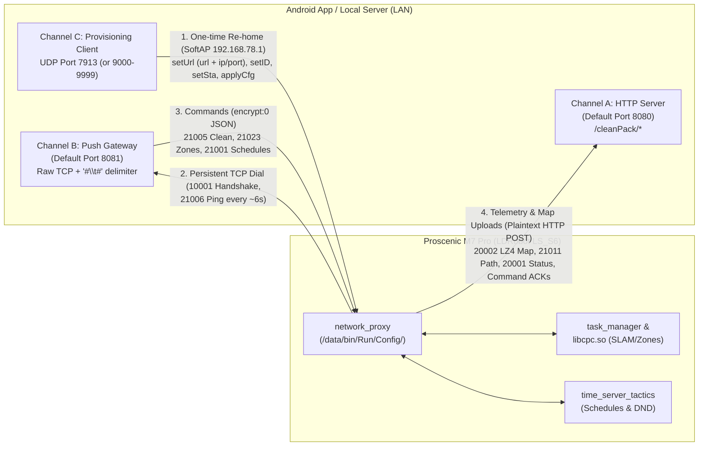

# Proscenic M7 / M7 Pro — Complete Protocol & Repository Research

> [!IMPORTANT]
> The Proscenic M7 Pro (hardware platform **LDRobot `LS_S6`**, Rockchip RK3308 running Linux) has been **completely reverse-engineered** down to its decompiled `network_proxy`, `libcpc.so`, `task_manager`, and `time_server_tactics` binaries. It can operate **100% locally without rooting or custom firmware** by re-homing its cloud/gateway endpoints over its local UDP pairing channel.

---

## 1. Key GitHub Repositories Discovered

| Repository | Focus | Key Takeaways |
| :--- | :--- | :--- |
| **`inequation/noobscenic`** | **100% Local Replacement Server (Rust)** | Clean-room replacement cloud & gateway server with full binary decompilation docs (`doc/reverse-engineering/`). Includes `tools/rehome.py` (pairs the vacuum over SoftAP UDP to point at a local IP), 2D map + path decoding, zone editor, spot clean, and room merging/splitting. Only omits schedules by author choice, though the schedule protocol (`21001`/`21002`) is fully documented in `FUNC_COMMANDS.md`. |
| **`Fluepke/proscenic`** | **Initial Reverse Engineering & Firmware Dump** | Discovered that the robot performs **no TLS certificate validation**, uploads LZ4-compressed maps (`infoType: 20002`) via HTTP `POST /cleanPack/uploadEvents`, uses `AES-128-ECB` on the TCP gateway with the 16-byte session token, and includes an extracted `firmware.bin` (`LS_S6` v0.7.1). |
| **`JuliusBlueTek/Proscenic-Home-Assistant`** | **Home Assistant Custom Component (Cloud + Map)** | Implements a Python client (`proscenicapis.py`) that logs into `mobile.proscenic.tw` / `.com.de` / `.cn`, opens the `#\t#`-delimited TCP socket (`infoType 70001`), decrypts `20001` (status), `20002` (LZ4 map), and `21011` (path), and renders a live 2D PIL image for Home Assistant's `camera` entity. |
| **`Musashi1965/ioBroker.proscenic`** | **TypeScript Protocol & Live Map Implementation** | Clean TypeScript implementation of the gateway TCP framing, LZ4 map decoding, animated live map viewer (`www/map-viewer/`), consumables (`21015`), and guarded zone cleaning. |
| **`andker87/Proscenic-M7-PRO`** | **Home Assistant REST Package** | Documents the cloud relay REST endpoints (`/instructions/cmd21005/<sn>`, `/instructions/<sn>/21012`, `/instructions/<sn>/21017`, `/instructions/<sn>/21022`) and segment/zone parameters (`segmentId`). |
| **`its-tech-nik/Proscenic-Local-Vacuum-for-Home-Assistant`** | **Tuya LAN Protocol (Newer Models)** | Targets newer Tuya-based Proscenic models (Q8, 850T, M8 Pro) on TCP port `6668`. *(Note: The M7 Pro `811_LDS` / `LS_S6` uses the LDRobot `cleanPack` protocol below, **not** Tuya LAN 6668, though some late hardware revisions used the BaoLe/YouRen `com.baole.blap` app wrapper over the same LDRobot firmware).* |

---

## 2. Firmware & Communication Architecture

The M7 Pro firmware (`network_proxy`) speaks **three distinct network channels**:



### Channel C — Local SoftAP Provisioning & Re-homing (UDP `7913`)
When you hold **Power + Home** for 5 seconds, the vacuum enters pairing mode and broadcasts an open Wi-Fi AP (`Proscenic-XXXX` or `LDRobot`) at **`192.168.78.1`**, listening for UDP JSON datagrams on port **`7913`** (or `9000–9999` on older builds).

To permanently point the vacuum at your own local server/app instead of Proscenic's cloud (no root required):
1. **Discover & Read Serial:** Send `{"cmd":"getSn"}` → returns `{"result":"ok","sn":"<SN>"}`.
2. **Set Channel-A Base URL:** Send `{"cmd":"setUrl","url":"http://<local-server-ip>:8080/"}` (writes `/data/bin/Run/Config/url`).
3. **Set Channel-B Gateway IP/Port (Critical Step):** Send `{"cmd":"setUrl","ip":"<local-server-ip>","port":8081}` (writes `/data/bin/Run/Config/ip_port.json` and updates the live connection object immediately).
4. **Arm Binding:** Send `{"cmd":"setID","id":"<any-userId>","deviceSN":"<SN>"}` → replies `{"cmd":"getID","result":"ok","type":"ipfromapp"}`.
5. **Configure Wi-Fi Credentials:** Send `{"cmd":"setSta","staName":"<SSID>","staPwd":"<8-64 char password>"}`.
6. **Commit & Join LAN:** Send `{"cmd":"applyCfg"}` → tears down SoftAP, connects to your home Wi-Fi, and dials your server.
   > [!CAUTION]
   > **Never send `{"cmd":"bindOk"}`** on M7 Pro firmware! In `network_proxy` (`FUN_00463c60`), `bindOk` closes the UDP file descriptor without stopping the listener thread, causing an infinite loop that forks ~85 shell processes per second.

---

### Channel B — Realtime Push Gateway (Raw TCP, `#\t#` Delimited)
The **robot dials out** to the `ip:port` stored in `ip_port.json` over a persistent raw TCP socket.
- **Framing:** Every message in both directions is UTF-8 JSON terminated by the 3-byte sequence **`#\t#`** (`0x23 0x09 0x23`).
- **Handshake (`10001`):** Immediately upon connecting, the robot sends:
  ```json
  {"infoType": 10001, "connectionType": 1, "data": {"token": "", "sn": "<SN>"}}
  ```
- **Heartbeat (`21006`) — Mandatory for Map Uploads:** Every ~6 seconds, the robot sends `{"infoType":21006,"data":{}}#\t#`. If unanswered for 15 seconds, the robot disconnects and reconnects.
  - Furthermore, **the robot will only upload maps and live status if the pong tells it an app is connected (`isExistConnect: true`)** inside the required outer `encrypt` envelope:
    ```json
    {"encrypt":0,"data":{"infoType":21006,"data":{"isExistConnect":true}}}#\t#
    ```
- **Bypassing AES Encryption (`encrypt: 0`):**
  - While the vendor cloud uses `encrypt: 1` (`AES-128-ECB` with the 16-byte session key), decompilation of `FUN_00457f08` (`interface_obj.cpp`) proved that if the outer envelope has **`"encrypt": 0`**, the robot accepts `data` as a **plaintext JSON object** directly!
  - Every command sent from the server/app to the robot uses this double-nested envelope:
    ```json
    {
      "encrypt": 0,
      "data": {
        "infoType": 21005,
        "data": { "mode": "smartClean" },
        "dInfo": { "ts": "1700000000", "userId": "local" }
      }
    }#\t#
    ```
    *(Note: `dInfo.ts` and `dInfo.userId` must be strings so the robot posts command acknowledgments back to Channel A `cleanPack/response`.)*

---

### Channel A — HTTP REST Telemetry & Map Receiver (`cleanPack/*`)
The robot sends HTTP `POST` (form-urlencoded) and `GET` requests to the base URL configured in `/data/bin/Run/Config/url`:

| Endpoint | Method | Robot Request / Server Response |
| :--- | :--- | :--- |
| `/cleanPack/binding` | `POST` | Fired during initial pairing (`sn=<SN>&ts=<SN>&userId=<id>`). Server responds `{"code":0,"message":"ok","data":{}}` to complete pairing. |
| `/cleanPack/register` | `POST` | Fired on boot (`sn=<SN>&ld_sn=<hex>&sig=<b64>&ts=0`). Server responds `{"code":0,"message":"ok","data":{"bindStatus":1,"session":"0123456789abcdef","cookies":"<32-char-sid>"}}`. Robot sends `Cookie: cookies=<sid>` on subsequent requests. |
| `/cleanPack/getSockAddr` | `GET` | Fallback gateway lookup (`?version=1&sn=<SN>&companyId=48`). Server responds `{"code":0,"message":"success","data":{"addr_list":[{"ip":"<server-ip>","port":8081}]}}`. |
| `/cleanPack/sync` | `POST` | Reports firmware/MCU versions (`sn=...&mcuVer=S6&version=0.7.1...`). Server responds `{"code":0,"data":{}}`. |
| `/cleanPack/uploadEvents` | `POST` | **Primary Telemetry & 2D Map Upload.** Carries `data=<JSON>` containing `infoType: 20001` (live robot status/battery/pose) and **`infoType: 20002` (2D SLAM occupancy grid map)**. Server responds `{"code":0,"data":{}}`. |
| `/cleanPack/response` | `POST` | **Command Replies & Clean Path (`21011`).** Carries ACKs/results for commands sent on Channel B, including `infoType: 21011` (cleaning path coordinates), `21002` (stored schedules), `21004` (stored zones), and `21015` (consumables). |
| `/cleanPack/uploadSingle` | `POST` | Multipart upload of completed cleaning records (`20004`) and `.bkmap` backup map archives. Respond `{"code":0}`. |

---

## 3. Core Goal Breakdown: 2D Map, Zones, and Schedules

### A. Watching the 2D Floor Map & Live Path (`20002` & `21011`)

1. **Triggering Map Uploads:**
   - As long as Channel B replies to `21006` pings with `"isExistConnect": true`, the robot automatically posts `infoType: 20002` to `/cleanPack/uploadEvents` whenever the map or path ID changes (throttled to every 3 seconds).
   - You can also request an immediate map upload at any time by sending `infoType: 20002` or `21014` (with `"data":{}`) over Channel B.
2. **Decoding the `20002` Map Payload:**
   ```json
   {
     "infoType": 20002,
     "data": {
       "SN": "LSLDSM7PRO...",
       "mapId": 1607215533,
       "autoAreaId": 12,
       "pathId": 1607237159,
       "width": 109,
       "height": 98,
       "resolution": 0.05,
       "x_min": -4.93,
       "y_min": -2.83,
       "lz4_len": 935,
       "area": [ ... ],
       "map": "<Base64-encoded LZ4 block>",
       "base64_len": 1248,
       "chargeHandlePos": [-120, 350],
       "chargeHandlePhi": 3142,
       "chargeHandleState": "find"
     }
   }
   ```
   - **Decompression:** Base64-decode `map` (after replacing spaces with `+` if URL-decoded), then decompress using **raw LZ4 block decompression** (`LZ4_decompress_safe`) with uncompressed size `width * height` bytes.
   - **Pixel / Cell Values (row-major `width × height`):**
     - `0x00` (`0`) = **Wall / Obstacle**
     - `0x7F` (`127`) = **Unknown / Unexplored** (outside walls)
     - `0xFF` (`255`) = **Free floor (unsegmented)**
     - `0x01 .. 0xFE` (excluding `0x7F`) = **Free floor belonging to auto-segmented Room ID `label`** (each integer is a distinct room color!)
   - **Coordinate Math (World Millimeters ↔ Grid Cells):**
     - Each cell is `resolution = 0.05` m (`50 mm`).
     - Because `network_proxy` subtracts `0.05` m when serializing `x_min`/`y_min`, the world coordinate (in mm) of cell `(col, row)`'s center is:
       $$x_{\text{mm}} = 1000 \times (x_{\text{min}} + 0.05 + \text{col} \times \text{resolution})$$
       $$y_{\text{mm}} = 1000 \times (y_{\text{min}} + 0.05 + \text{row} \times \text{resolution})$$
     - Inverse (world mm → grid pixel):
       $$\text{col} = \frac{x_{\text{mm}}/1000 - x_{\text{min}} - 0.05}{\text{resolution}}, \quad \text{row} = \frac{y_{\text{mm}}/1000 - y_{\text{min}} - 0.05}{\text{resolution}}$$
     - Row `0` is the bottom-most world $Y$; flip vertically (`screenY = height - 1 - row`) when rendering to an Android `Canvas` or `Bitmap`.
   - **Robot Pose & Dock Position:**
     - Live status (`infoType: 20001`) reports `"pos": [x_mm, y_mm]` and `"phi": <mrad>` (heading in thousandths of a radian).
     - Dock position is `"chargeHandlePos": [x_mm, y_mm]` and `"chargeHandlePhi": <mrad>` (with a $+\pi$ offset: $\theta_{\text{rad}} = \text{chargeHandlePhi}/1000 - \pi$).
3. **Fetching the Cleaning Trail (`21011`):**
   - Send `{"infoType":21011,"data":{"startPos":0,"mask":0},"dInfo":{"ts":"...","userId":"..."}}` on Channel B.
   - Robot posts `infoType: 21011` to `/cleanPack/response` with `"posArray": [[x0, y0], [x1, y1], ...]` in world millimeters. Mask out the low 2 tag bits (`x & ~3`, `y & ~3`) and transform to grid coordinates.

---

### B. Creating & Cleaning Zones / Rooms / No-Go Areas (`21003`, `21004`, `21023`, `21005`)

The M7 Pro supports polygon regions (in world millimeters) for **cleaning zones**, **no-go zones**, **no-mop zones**, and **auto-segmented rooms**:

1. **Region Object Schema:**
   ```json
   {
     "vertexs": [[-1025, 525], [475, 525], [475, -975], [-1025, -975]],
     "active": "normal",
     "forbidType": "all",
     "cleanType": "sweepOnly",
     "workNoisy": "auto",
     "name": "Kitchen",
     "tag": "kitchen",
     "id": 1,
     "mode": "area"
   }
   ```
   - `active`: `"normal"` (standard clean), `"depth"` (2x grid deep clean), or `"forbid"` (restricted zone).
   - `forbidType` (when `active == "forbid"`): `"all"` (No-Go zone), `"mop"` (No-Mop zone), `"sweep"` (No-Sweep zone).
   - `workNoisy`: `"quiet"`, `"auto"`, `"strong"`, `"max"`, `"mop"`.
   - **Safety Constraint:** Keep `name` and `tag` $\le 31$ UTF-8 bytes and `mode` $\le 30$ bytes (`libcpc.so` uses an unbounded 32-byte stack `strcpy`).
2. **Saving Persistent Zones (`21003` SetAreaTactics & `21004` GetAreaTactics):**
   - Read current stored zones with `infoType: 21004` (`"data": {}`).
   - Write the full list of zones (no-go zones + named user zones) with `infoType: 21003`:
     ```json
     {"infoType": 21003, "data": {"mapId": 1607215533, "value": [ ...regions... ]}, "dInfo": {"ts": "1", "userId": "local"}}
     ```
3. **Starting a Zone, Room, or Spot Clean (`21023` + `21005`):**
   > [!WARNING]
   > Sending `21023` (`ActiveRegions`) alone **only loads the target regions into shared memory**—it does not start the motors when idle. Sending `21005 {"mode":"smartClean"}` afterward **wipes shared memory** and cleans the whole house!
   - **Correct 2-step sequence to clean zones or rooms:**
     1. Send **`infoType: 21023`** with:
        - `"cleanId": [-3, 1, 2]` (`-3` keeps stored No-Go zones active; `1, 2` are stored region IDs from `21004`), **or**
        - `"cleanId": [-3]`, `"extraAreas": [ ...ad-hoc polygon regions... ]`, **or**
        - `"cleanId": [-3]`, `"segmentId": [3, 5]` (room label bytes from the `20002` map raster).
     2. Wait for the `21023` ACK on `/cleanPack/response`, then immediately send **`infoType: 21005` with `{"mode": "appointClean"}`**. This launches `clean_task` using the exact regions loaded by `21023`!
4. **Room Merge / Split / Reset (`21030`):**
   - Merge rooms: `{"infoType":21030,"data":{"autoAreaId":<id>,"operate":"merge","extra":{"pixel1":3,"pixel2":4}}}`
   - Split room: `{"infoType":21030,"data":{"autoAreaId":<id>,"operate":"split","extra":{"pixel":3,"p1":[x1_mm,y1_mm],"p2":[x2_mm,y2_mm]}}}`
   - Reset auto-partition: `{"infoType":21030,"data":{"autoAreaId":<id>,"operate":"reset"}}`

---

### C. Setting Up Schedules & Quiet Hours (`21001` & `21002`)

 Schedules execute **autonomously on the robot** via its internal `time_server_tactics` daemon (or can also be triggered by a local server/Home Assistant).

- **Set Schedules (`infoType: 21001`):** Replaces the schedule list in `/tmp/Run/Config/time_setting.json`:
  ```json
  {
    "infoType": 21001,
    "data": {
      "timeZone": -8,
      "value": [
        {
          "active": true,
          "unlock": true,
          "startTime": 32400,
          "endTime": 0,
          "period": [1, 3, 5],
          "workNoisy": "auto",
          "cleanNum": 1,
          "cleanId": [-1, -3]
        }
      ]
    },
    "dInfo": { "ts": "1", "userId": "local" }
  }
  ```
  - `timeZone`: Integer UTC offset in hours (e.g., `-8` for PST). Note: the robot syncs UTC via NTP (`0.pool.ntp.org`, `us.ntp.org.cn`).
  - `active`: `true` = cleaning schedule, `false` = Do-Not-Disturb (quiet hours) window.
  - `unlock`: `true` = enabled, `false` = disabled (paused schedule).
  - `startTime`: For weekly schedules (`period` non-empty), **seconds since local midnight** (e.g. `32400` = 09:00 AM). For one-shot schedules (`period: []`), Unix epoch timestamp.
  - `period`: Array of weekday integers where **`0` = Sunday, `1` = Monday, …, `6` = Saturday**.
  - `workNoisy`: `"quiet"`, `"auto"`, `"strong"`, or `"max"`.
  - `cleanId`: `[-1, -3]` for whole-home respecting no-go zones, or specific stored zone IDs `[1, 2, -3]`.
- **Read Schedules (`infoType: 21002`):** Send `{"infoType":21002,"data":{},"dInfo":{"ts":"1","userId":"local"}}` to read back the active schedule table via `/cleanPack/response`. Always verify a `21001` write with a `21002` read.

---

### D. Complete Command Quick Reference (Channel B `infoType`)

| Action | `infoType` | `data` Payload |
| :--- | :--- | :--- |
| **Whole-Home Clean** | `21005` | `{"mode": "smartClean"}` |
| **Deep Clean (2x Grid)** | `21005` | `{"mode": "depthTotalClean"}` |
| **Y-Shaped Mop Clean** | `21005` | `{"mode": "smartClean", "pathType": "y_word"}` |
| **Start Selected Zones/Rooms** | `21005` | `{"mode": "appointClean"}` *(after `21023`)* |
| **Pause / Resume / Stop** | `21017` | `{"cmd": "pause"}` / `{"cmd": "continue"}` / `{"cmd": "stop"}` |
| **Return to Dock** | `21012` | `{"cmd": "start"}` (`"pause"` / `"stop"` to cancel) |
| **Set Suction Power** | `21022` | `{"cmd": "quiet" \| "auto" \| "strong" \| "max" \| "mop"}` |
| **Set Mop Water Level** | `21024` | `{"cmd": "setWaterPump", "value": 1..4}` |
| **Set Speaker Volume** | `21024` | `{"cmd": "setVolume", "value": 0..10}` |
| **Empty Dustbin Station** | `21024` | `{"cmd": "startDustCenter", "value": 0}` |
| **Delete Current Map** | `21024` | `{"cmd": "delCurMap"}` |
| **Spot Clean (Here)** | `21020` | `{"ctrlCode": 3001}` |
| **Locate Robot (Beep)** | `21020` | `{"ctrlCode": 3010}` (`3011` to stop) |
| **Manual D-Pad Steering** | `21020` | `{"ctrlCode": 3005}` (Fwd), `3006` (Back), `3007` (Left), `3008` (Right), `4001` (Stop), `4000` (Exit RC) *(repeat every $\le 300\text{ ms}$ while held)* |
| **Query Status / Consumables** | `20001` / `21015` | `{}` |
